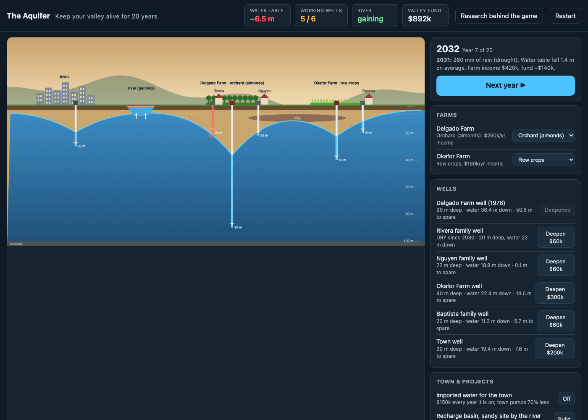

# The Aquifer

Keep your valley alive for 20 years without exhausting its groundwater.
Playable prototype, static files only: open `index.html`.

## Files

| File | What it is |
|------|------------|
| `index.html` | Page: header stats, cross-section canvas, action panel, timeline chart, event and research modals |
| `style.css` | Dark theme, responsive (two columns above 900 px, stacked below) |
| `sim.js` | Simulation core. Works in a browser (`window.AquiferSim`) and in Node (`module.exports`) |
| `game.js` | Drawing, animation, story beats, UI wiring |
| `test_sim.js` | Node script: three scripted 20-year playthroughs for balance checks |

## The model (all numbers invented; relationships research-backed)

The aquifer is a 1-D strip of 64 columns, 100 m each, 100 m thick, specific
yield 0.15. State is depth-to-water per column. Each year:

- **Recharge**: 30% of rainfall reaches the water table; a little mountain-front
  inflow at the valley edges.
- **Pumping**: each working well withdraws at its column. Orchard 650,000 m³,
  row crops 380,000 m³, town 420,000 m³ (30% of that with imported water on),
  households negligible. Dry years raise irrigation demand by up to 48%.
- **Lateral flow**: explicit diffusion with coefficient 50,000 m²/yr, so pumping
  carves a cone of depression that spreads to neighbouring wells.
- **River**: at column 20, bed 7.5 m below the surface. Water table above the
  bed means a gaining river; below it, losing; more than 6 m below, disconnected.
- **Recharge basins**: only capture water in wet years (rain above 450 mm).
  The sandy site by the river passes 100% of what it captures; the clay site 30%.
- **Wells fail** when the water table drops below the pump intake, 3 m above
  the bottom of the well. Six wells: three household (20–22 m), two farm
  (32 m, 40 m), one town (30 m). Deepening goes to 45 / 90 / 70 m.
- **Money**: the player runs a valley fund fed by a 12% levy on farm income
  plus $90k of town water rates. Actions cost $60k–$300k. Farm income is the
  economy score, not the player's purse.

Rainfall is scripted (two normal years, a four-year drought, an atmospheric
river, a mixed back half) so the lesson lands in the first five minutes.

## Story beats

1. Mission card.
2. First drought year: warning.
3. Delgado Farm's 1978 well sputters: offer to deepen it for $300k.
4. A household well runs dry. "Why?" highlights the cone of depression under
   the farm well and cites Jasechko & Perrone (2021).
5. River turns losing, then disconnects, if the decline continues.
6. First atmospheric-river year: with or without a basin, the card explains
   what a basin would have caught.
7. Recovery card when the water table rises in a non-wet year.
8. 2046: five-star grade over household wells, water-table change, recovery
   trend, river state and farm income, with a one-line verdict.

## Balance (from `test_sim.js`, 2026-10-09)

| Strategy | Dry wells by 2045 | Water table vs 2026 | River | Farm income |
|---|---|---|---|---|
| Do nothing | Delgado farm well (2029); families survive because the farm stops pumping | −4.7 m | gaining | $4.0M |
| Deepen the farm well in 2028 | Rivera (2030), Nguyen (2032), Baptiste (2042) | −16.5 m | losing | $8.4M |
| 60% cap + sandy basin + row crops + imported water | none | +0.7 m, rising | gaining | $6.1M |

## Verification record

Rendered in headless Chrome on 2026-10-09: start screen, year six after
deepening the farm well (cone of depression visible, Rivera well dry), end card,
and phone width (420 px). No console errors. One bug found and fixed: the
water-table tween used a clock that can run ahead of the first animation frame,
so it now starts on the first frame and snaps to the end state if frames are
paused.

## Known gaps

- Citation 4 (Jasechko 2026, *Science*, 67 recovery cases) is as supplied by
  AL and should be confirmed with the author before classroom use.
- The clay lens is drawn only as a visual cue; it does not affect flow.
- No touch-specific controls, no sound, no save state.
